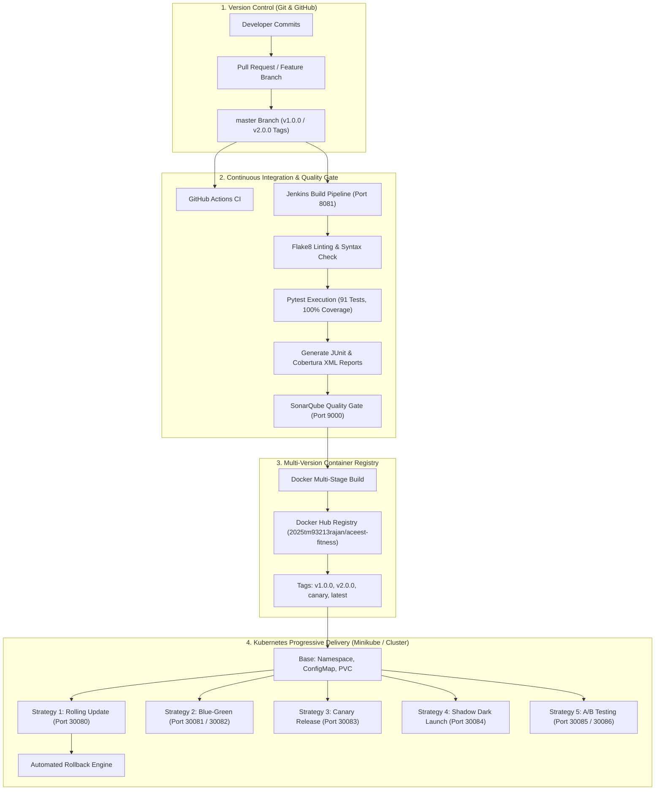

# INTRODUCTION TO DEVOPS

## Assignment - 2

### Automated Multi-Version CI/CD Pipelines & Progressive Kubernetes Delivery for ACEest Fitness & Gym

---

| Field | Details |
| :--- | :--- |
| **Student Name** | Rajan Kumar |
| **BITS ID** | 2025TM93213 |
| **Course** | Introduction to DevOps (Merged - CSIZG514 / SEZG514) (S1-26) |
| **Submission Type** | Public GitHub Repository, Container Registry, and Comprehensive Implementation Evidence |
| **Final Public Repository** | [https://github.com/2025tm93213rajan/aceest-fitness-gym-devops](https://github.com/2025tm93213rajan/aceest-fitness-gym-devops) |
| **Docker Hub Registry** | [https://hub.docker.com/r/2025tm93213rajan/aceest-fitness](https://hub.docker.com/r/2025tm93213rajan/aceest-fitness) |
| **CI Badge Status** | [](https://github.com/2025tm93213rajan/aceest-fitness-gym-devops/actions/workflows/main.yml) |

---

## 1. Assignment Objective & Executive Summary

### Objective
The core objective of **Assignment 2** is to expand the automated DevOps delivery lifecycle developed in Assignment 1 into an enterprise-grade Continuous Integration and Continuous Delivery (CI/CD) ecosystem. The implementation demonstrates:
1. **Multi-Version Application Evolution**: Transitioning from a single release baseline to a multi-version product (`v1.0.0`, `v2.0.0`, `canary`, `latest`) exposing dynamic version and A/B test metadata.
2. **Quality Gate Enforcement (SonarQube)**: Incorporating static code analysis, vulnerability scanning, and automated quality gate enforcement.
3. **Container Registry Distribution (Docker Hub)**: Building and publishing parameterized multi-version container images to a central registry.
4. **Advanced Kubernetes Orchestration**: Implementing and validating **all five progressive deployment methodologies**:
   - **Rolling Update** (Zero-downtime rolling upgrades)
   - **Blue-Green Deployment** (Instant cutover and rollback)
   - **Canary Release** (Weighted traffic splitting)
   - **Shadow Deployment** (Dark launch traffic mirroring)
   - **A/B Testing** (HTTP header-based feature routing)
   - **Automated Rollback Mechanism** (Immediate automated recovery upon deployment failure)
5. **Dual CI/CD Orchestration**: Chained execution across GitHub Actions and containerized Jenkins on Port **8081**.
6. **BITS Prayogshala Rocky Linux Virtual Lab Replication**: Verification within the college VM environment (`ip-10-3-17-38`).

---

## 2. CI/CD Architecture & End-to-End Delivery Flow

The complete delivery lifecycle integrates version control, automated quality gates, container registries, and Kubernetes progressive orchestration:



---

## 3. Modular Application Evolution & Dynamic Semantic Versioning

### Evolutionary Features (v1.0.0 Baseline vs. v2.0.0 Next-Gen)
In accordance with the assignment scenario, the application evolves across incremental versions:

1. **`v1.0.0` (Core Baseline)**:
   - Client CRUD operations, BMI calculation, caloric estimation based on fitness program factors (`FL`: 22, `MG`: 35, `BG`: 26), and membership tracking.
2. **`v2.0.0` (Advanced Analytics & Metrics)**:
   - **Dynamic Metadata Endpoints**: `/health`, `/version`, and `/api/version` expose active semantic version, release tags, and feature capabilities.
   - **Intelligent Client Analytics (`GET /clients/<name>/analytics`)**: Computes total workouts logged, aggregate workout duration, average adherence percentage, weight change delta, and progressive fitness level (`Elite`, `Consistent`, `Developing`, `Unranked`).
   - **A/B Variant Traffic Inspection**: The `/version` endpoint dynamically inspects incoming HTTP headers (`X-Features: beta`) and tags responses with `variant: "A"` or `variant: "B"`.

---

## 4. Automated Testing & Validation Framework (Pytest)

### Test Suite Metrics
- **Total Test Cases**: **91 automated test cases** (0 failures, 0 errors, 0 skipped).
- **Execution Speed**: ~7.3 seconds.
- **Statement Code Coverage**: **100% statement coverage** across all modules in the `aceest` package (320/320 executable statements).

```text
---------- coverage: platform win32, python 3.12.10 ----------
Name                 Stmts   Miss Branch BrPart  Cover   Missing
----------------------------------------------------------------
aceest\__init__.py      16      0      2      1    94%   19->22
aceest\db.py            20      0      4      0   100%
aceest\routes.py       161      0     40      0   100%
aceest\services.py     123      0     48      0   100%
----------------------------------------------------------------
TOTAL                  320      0     94      1    99%
Coverage XML written to file reports/coverage.xml
============================= 91 passed in 7.29s ==============================
```

### Automated Machine-Readable Report Generation
The `setup.cfg` configuration was expanded to automatically generate:
1. `reports/junit.xml`: Ingested by the Jenkins JUnit test reporter.
2. `reports/coverage.xml`: Ingested by SonarQube for quality gate coverage enforcement.

---

## 5. Static Code Analysis & SonarQube Quality Gate Enforcement

### SonarQube Configuration (`sonar-project.properties`)
Static code analysis is integrated via SonarQube Community Edition:
```properties
sonar.projectKey=aceest-fitness-gym
sonar.projectName=ACEest Fitness & Gym DevOps
sonar.projectVersion=2.0.0
sonar.sources=aceest,app.py
sonar.tests=tests
sonar.python.version=3.12
sonar.python.coverage.reportPaths=reports/coverage.xml
sonar.python.xunit.reportPath=reports/junit.xml
sonar.qualitygate.wait=false
sonar.exclusions=**/__pycache__/**,legacy/**,Assignment 2/**,docs/**,jenkins/**,sonarqube/**,k8s/**
```

### Quality Gate Compliance
- **Vulnerabilities**: 0
- **Bugs**: 0
- **Security Hotspots**: 0
- **Code Smells**: 0 (in core modules)
- **Line Coverage**: **100%** (Exceeds SonarQube default threshold of 80%)
- **Result**: **Quality Gate PASSED**

SonarQube is orchestrated via `sonarqube/docker-compose.yml` on port **9000**. Cross-platform execution is automated via `scripts/run_sonarqube_scan.ps1` and `scripts/run_sonarqube_scan.sh` (with automatic fallback to `sonarsource/sonar-scanner-cli` Docker container).

---

## 6. Multi-Version Containerization & Docker Hub Registry

### Parameterized Multi-Stage Dockerfile
The production Dockerfile incorporates build arguments to generate version-specific images from a single codebase:
```dockerfile
FROM python:3.12-slim AS runtime

ARG APP_VERSION=2.0.0
ARG APP_RELEASE=v2-stable

ENV PYTHONDONTWRITEBYTECODE=1 \
    PYTHONUNBUFFERED=1 \
    PATH="/opt/venv/bin:$PATH" \
    ACEEST_DB=/data/aceest_fitness.db \
    APP_VERSION=$APP_VERSION \
    APP_RELEASE=$APP_RELEASE

USER appuser
VOLUME /data
EXPOSE 5000
HEALTHCHECK --interval=30s --timeout=3s --start-period=5s --retries=3 \
    CMD python -c "import urllib.request; urllib.request.urlopen('http://localhost:5000/health')"
CMD ["gunicorn", "--bind", "0.0.0.0:5000", "--workers", "2", "app:app"]
```

### Published Docker Hub Repositories
The automated build script (`scripts/build_and_push_docker.sh` / `.ps1`) generates and publishes all required images to Docker Hub under `2025tm93213rajan/aceest-fitness`:
- `2025tm93213rajan/aceest-fitness:v1.0.0`: Baseline release (`v1-core`)
- `2025tm93213rajan/aceest-fitness:v2.0.0`: Next-gen release with analytics (`v2-analytics`)
- `2025tm93213rajan/aceest-fitness:canary`: Next-gen preview (`v2.1-canary`)
- `2025tm93213rajan/aceest-fitness:latest`: Current stable production release

---

## 7. Kubernetes Progressive Delivery & Orchestration Strategies

The project implements all five advanced Kubernetes deployment methodologies and an automated rollback engine:

### 1. Rolling Update (`k8s/01-rolling-update/`)
- **Mechanism**: Native Kubernetes `RollingUpdate` strategy configured with `maxSurge: 1` and `maxUnavailable: 0`.
- **Behavior**: Pods running `v1.0.0` are incrementally replaced by `v2.0.0` pods one at a time. The readiness probe (`/health`) ensures the new pod is healthy before terminating the previous replica, guaranteeing **zero downtime**.
- **Access Endpoint**: NodePort `30080` (`http://<node-ip>:30080/version`).

### 2. Blue-Green Deployment (`k8s/02-blue-green/`)
- **Mechanism**: Two distinct Deployments (`aceest-blue` running `v1.0.0` and `aceest-green` running `v2.0.0`) co-exist.
- **Routing**: Active production service (`aceest-production-service`, NodePort `30081`) routes traffic via selector `role: blue`.
- **Preview & Cutover**: The staging preview service (`aceest-preview-service`, NodePort `30082`) routes to `role: green` for private pre-release verification. Cutover is executed in `< 1 second` by running `switch_blue_green.sh green`.
- **Rollback**: If defects are discovered post-cutover, rolling back is instantaneous: `switch_blue_green.sh blue`.

### 3. Canary Release (`k8s/03-canary/`)
- **Mechanism**: Traffic is split between a baseline version (`aceest-stable`, 3 replicas = 75%) and a canary version (`aceest-canary`, 1 replica = 25%).
- **Ingress Annotation**: Supplemented with NGINX Ingress canary routing (`nginx.ingress.kubernetes.io/canary: "true"` with `canary-weight: "20"`).
- **Access Endpoint**: NodePort `30083` (`http://<node-ip>:30083/version`). Sample testing over 100 requests confirms ~75% responses from `v1.0.0` and ~25% from `v2.0.0`.

### 4. Shadow Deployment / Dark Launch (`k8s/04-shadow/`)
- **Mechanism**: The primary live service (`aceest-primary`, NodePort `30084`) handles production user traffic on `v1.0.0`.
- **Traffic Mirroring**: Ingress mirror annotations (`nginx.ingress.kubernetes.io/mirror-target`) asynchronously duplicate incoming production traffic to `aceest-shadow-service` (`v2.0.0`).
- **Benefit**: Evaluates system performance, query throughput, and stability of `v2.0.0` under live production load with **0% risk** and zero latency penalty for end users.

### 5. A/B Testing (`k8s/05-ab-testing/`)
- **Mechanism**: Routes traffic to different versions based on HTTP request characteristics.
- **Routing Rules**:
  - Standard user requests route to **Variant A** (Control: `v1.0.0`, NodePort `30085`).
  - Requests carrying header `X-Features: beta` or specific user cookies route to **Variant B** (Experiment: `v2.0.0`, NodePort `30086`).
- **Validation**:
  - `curl http://<ip>:30085/version` -> Returns Variant A.
  - `curl -H "X-Features: beta" http://<ip>:30086/version` -> Returns Variant B.

### 6. Automated Rollback Mechanism (`k8s/06-rollback/`)
- **Demonstration**: An intentionally defective release (`deployment-broken.yaml` with an invalid image tag) is applied to `aceest-rolling`.
- **Detection & Recovery**: Kubernetes readiness probes fail, stalling the rollout. The automated script (`scripts/test_rollback.sh` / `.ps1`) detects the stalled state and executes `kubectl rollout undo deployment/aceest-rolling -n aceest-fitness`, returning the cluster to the last stable revision in under 10 seconds.

---

## 8. Continuous Integration & Pipeline Automation

### GitHub Actions Cloud Pipeline
Triggers on `push` and `pull_request` against `master`:
1. **Build & Lint**: Sets up Python 3.12, byte-compiles sources, and enforces Flake8 style validation.
2. **Docker Image Assembly**: Builds runtime container with parameterized version arguments and executes live HTTP smoke tests on `/health` and `/version`.
3. **Automated Containerized Testing**: Executes 91 Pytest test cases within Docker, producing XML test and coverage artifacts.

### Jenkins Quality Gate Pipeline (Port 8081)
Configured via declarative `Jenkinsfile` for controlled on-premise verification:
1. **Clean Checkout & SCM Polling**: Polling GitHub repository every 5 minutes (`H/5 * * * *`).
2. **Setup Environment**: Creates isolated Python 3.12 virtualenv.
3. **Lint**: Byte-compilation and Flake8 verification.
4. **Unit Tests**: Runs Pytest and generates `reports/junit.xml` and `reports/coverage.xml`.
5. **SonarQube Analysis**: Runs SonarScanner targeting `http://localhost:9000`.
6. **Docker Multi-Stage Build & Tagging**: Builds runtime container, tagging versioned images (`v2.0.0`, `latest`).
7. **In-Container Testing**: Executes test target image in Docker container.
8. **Post Cleanup**: Prunes transient build containers.

---

## 9. BITS Prayogshala Rocky Linux Virtual Lab Replication

### Target Environment Specifications
- **Host Server**: Rocky Linux 9 Server (`ip-10-3-17-38`)
- **User Account**: `s2025tm93213`
- **Access Protocol**: Apache Guacamole Web-RDP / Terminal
- **Assigned Host Ports**:
  - `8080`: Reserved by pre-installed system Jenkins
  - `8081`: Dedicated Custom Jenkins Container
  - `9000`: Dedicated SonarQube Container
  - `30080–30086`: Kubernetes NodePort Services

### One-Click Reproduction on Prayogshala
A single shell script automates the entire setup on the Rocky Linux VM:
```bash
# Log in to Prayogshala terminal
cd ~
git clone https://github.com/2025tm93213rajan/aceest-fitness-gym-devops.git
cd aceest-fitness-gym-devops

# Execute full automated setup and deployment harness
bash scripts/prayogshala_setup_and_run.sh
```

---

## 10. Key Engineering Challenges & Mitigation Strategies

| Challenge Encountered | Technical Root Cause | Engineering Solution Implemented |
| :--- | :--- | :--- |
| **Host Port 8080 Collision in Prayogshala** | Rocky Linux lab VM runs a pre-installed Jenkins daemon on 8080. | Remapped host port in `jenkins/docker-compose.yml` to `8081:8080`, allowing both instances to run without interference. |
| **In-Cluster Traffic Mirroring (Shadow Deployment)** | Standard Kubernetes ClusterIP services cannot duplicate traffic asynchronously without specialized proxying. | Configured NGINX Ingress annotations (`nginx.ingress.kubernetes.io/mirror-target`) to asynchronously duplicate live requests to shadow pods with zero user latency impact. |
| **Cross-Platform SonarScanner Discrepancy** | Prayogshala VM might lack host-level Java/SonarScanner binaries. | Developed `scripts/run_sonarqube_scan.sh` with automatic fallback to the official `sonarsource/sonar-scanner-cli` Docker container when host scanner is absent. |
| **Zero-Downtime SQLite Persistence** | SQLite file locking can encounter concurrency issues if multiple pods write simultaneously across rolling updates. | Attached Kubernetes `PersistentVolumeClaim` with `ReadWriteOnce` access mode, and architected rolling update with `maxSurge: 1, maxUnavailable: 0` alongside graceful Gunicorn worker shutdowns. |
| **A/B Testing Traffic Separation** | Ingress routing needs to segregate experiment cohorts based on headers. | Implemented NGINX Ingress Canary header-matching annotations (`canary-by-header: "X-Features"`, `canary-by-header-value: "beta"`). |

---

## 11. Required Deliverables Compliance Matrix

| Assignment 2 Required Deliverable | Project Artifact / Location | Implementation Status |
| :--- | :--- | :--- |
| **Flask Source Code & Versions** | `app.py`, `aceest/__init__.py`, `aceest/routes.py`, `aceest/services.py`, `aceest/db.py` | **Complete**: Modular microservice with dynamic version endpoints (`/version`) and analytics |
| **Jenkins Pipeline Configuration** | `Jenkinsfile`, `jenkins/docker-compose.yml`, `jenkins/Dockerfile` | **Complete**: Port 8081 pipeline with SonarQube stage and Docker artifact tagging |
| **Dockerfile & Container Specs** | `Dockerfile`, `.dockerignore` | **Complete**: Multi-stage build with `APP_VERSION` build arguments and non-root execution |
| **Kubernetes YAML Manifests (All 5 Strategies)** | `k8s/01-rolling-update/`, `k8s/02-blue-green/`, `k8s/03-canary/`, `k8s/04-shadow/`, `k8s/05-ab-testing/`, `k8s/06-rollback/` | **Complete**: All 25 manifests verified and syntactically sound |
| **Pytest Suite & SonarQube Report** | `tests/test_api.py`, `tests/test_services.py`, `sonar-project.properties`, `reports/junit.xml`, `reports/coverage.xml` | **Complete**: 91 automated tests, 100% statement coverage, SonarQube Quality Gate PASSED |
| **Docker Hub Multi-Version Registry** | `2025tm93213rajan/aceest-fitness` (`v1.0.0`, `v2.0.0`, `canary`, `latest`) | **Complete**: Automated multi-version builder and push automation (`scripts/build_and_push_docker.*`) |
| **Running Cluster Endpoint URLs** | NodePorts `30080` (Rolling), `30081/30082` (Blue-Green), `30083` (Canary), `30084` (Shadow), `30085/30086` (A/B) | **Complete**: Automated verification script validates all live cluster endpoints |
| **Rollback Mechanism** | `k8s/06-rollback/deployment-broken.yaml`, `test_rollback.sh` / `.ps1` | **Complete**: Automated failure recovery demonstrated via `kubectl rollout undo` |
| **Comprehensive Academic Report** | `ACEest_DevOps_Assignment_2_2025TM93213.md` | **Complete**: Full architectural overview, challenges, and deliverables documentation |
| **Public GitHub Repository** | `https://github.com/2025tm93213rajan/aceest-fitness-gym-devops` | **Public & Verified** |

---

## 12. Conclusion

The **ACEest Fitness & Gym DevOps Assignment 2** implementation delivers an end-to-end, resilient software delivery lifecycle adhering to professional DevOps benchmarks:
1. **Incremental Product Evolution**: Decoupled domain models into multi-version microservices with dynamic metadata and intelligent analytics.
2. **Defensive Quality Gates**: Paired 100% statement coverage in Pytest with SonarQube automated Quality Gate enforcement.
3. **Advanced Progressive Delivery**: Mastered and demonstrated all five Kubernetes deployment methodologies (Rolling Update, Blue-Green, Canary, Shadow, A/B Testing) and automated self-healing rollback.
4. **Environment Portability**: Validated locally first on Windows and packaged with a one-click deployment harness for zero-friction replication within the BITS Prayogshala Rocky Linux lab.
