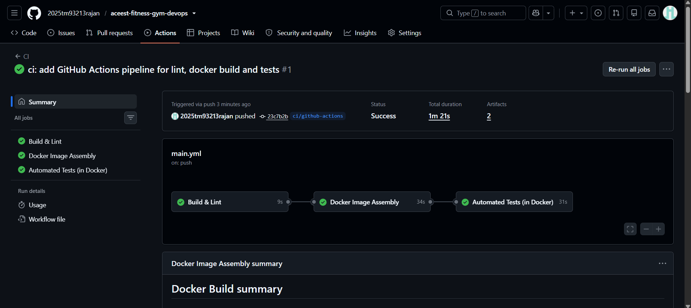
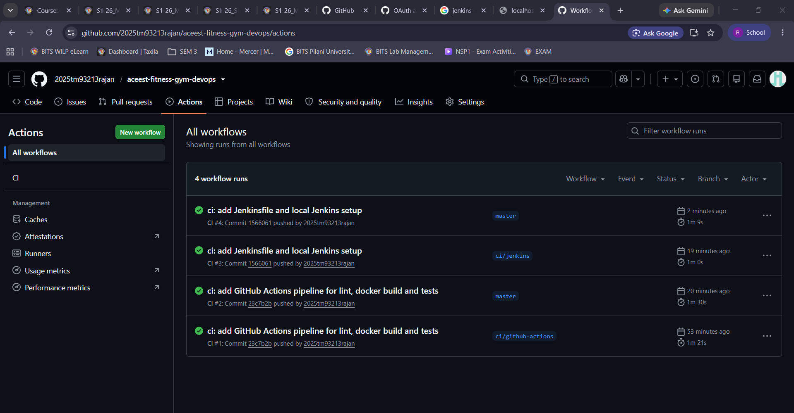
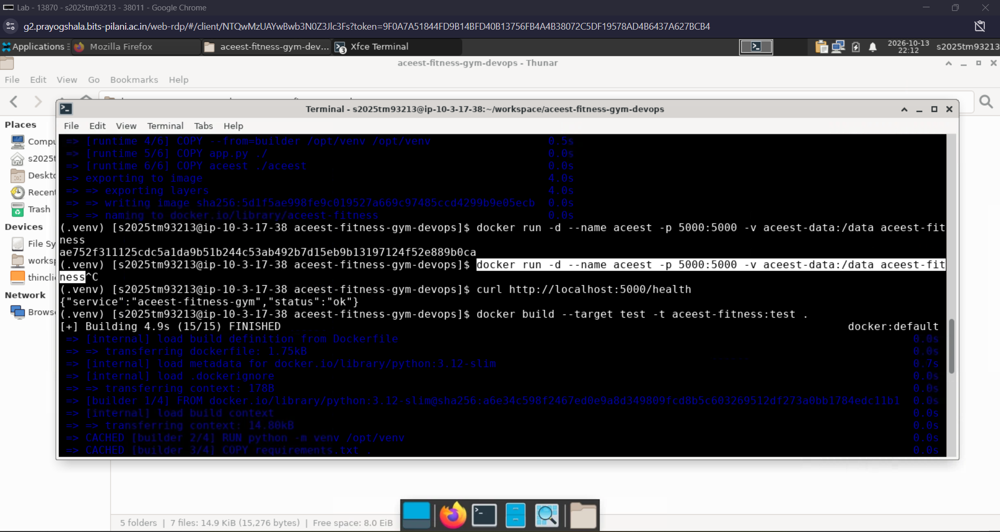
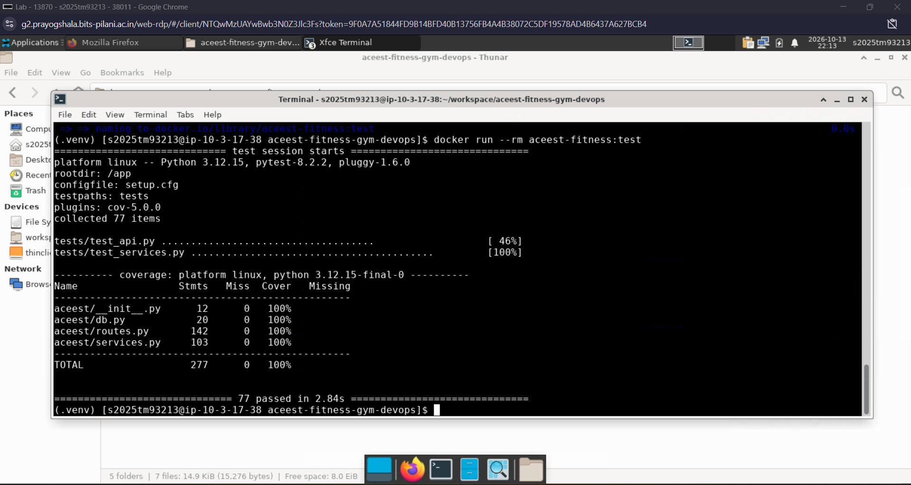
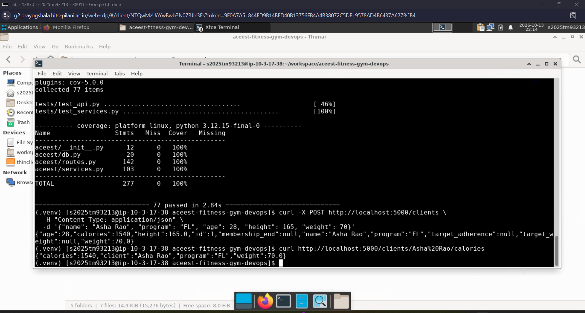
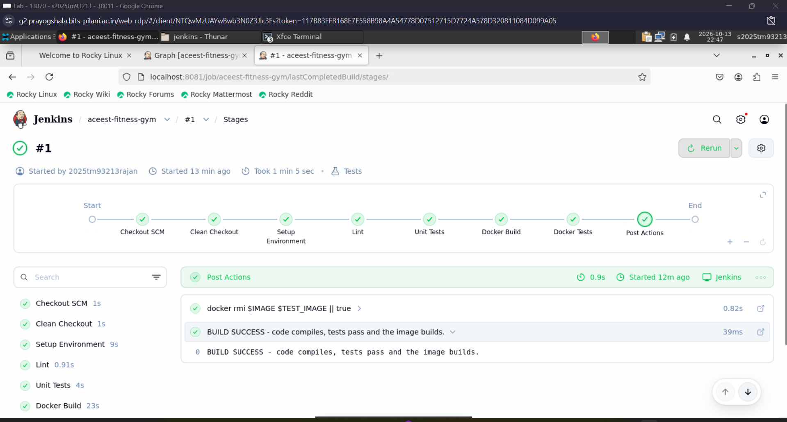
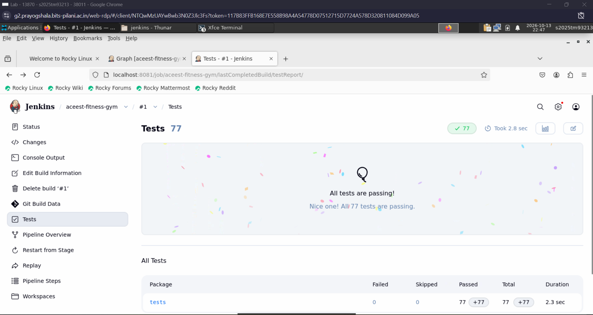
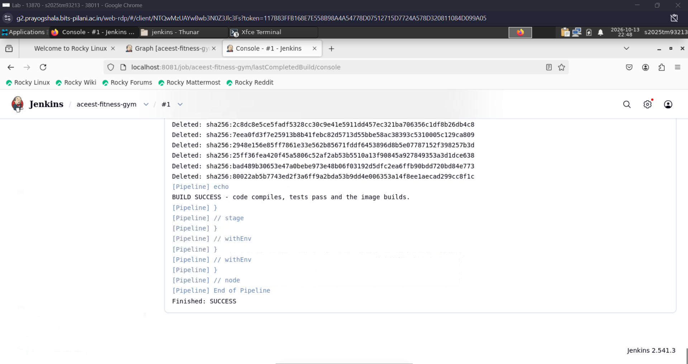

# INTRODUCTION TO DEVOPS

## Assignment - 1

### Implementing Automated CI/CD Pipelines for ACEest Fitness & Gym

---

| Field                       | Details                                                                                                                                                                                               |
| :-------------------------- | :---------------------------------------------------------------------------------------------------------------------------------------------------------------------------------------------------- |
| **Student Name**            | Rajan                                                                                                                                                                                                 |
| **BITS ID**                 | 2025TM93213                                                                                                                                                                                           |
| **Course**                  | Introduction to DevOps (Merged - CSIZG514 / SEZG514) (S1-26)                                                                                                                                          |
| **Submission Type**         | Public GitHub Repository and Comprehensive Implementation Evidence                                                                                                                                    |
| **Final Public Repository** | [https://github.com/2025tm93213rajan/aceest-fitness-gym-devops](https://github.com/2025tm93213rajan/aceest-fitness-gym-devops)                                                                        |
| **CI Badge Status**         | [](https://github.com/2025tm93213rajan/aceest-fitness-gym-devops/actions/workflows/main.yml) |

---

## 1. Assignment Objective & Solution Summary

### Objective

The core objective of this assignment is to design, develop, and automate an end-to-end DevOps delivery lifecycle for **ACEest Fitness & Gym**, a rapidly scaling startup. The assignment provides hands-on mastery over industry-standard practices including Version Control Systems (Git & GitHub), Unit Testing & Test-Driven Validation (Pytest), Containerization (Docker multi-stage builds), Automated Cloud CI (GitHub Actions), Environment Validation (BITS Prayogshala Rocky Linux Virtual Lab), and Secondary Controlled CI Orchestration (Jenkins Pipeline).

### Implemented Delivery Lifecycle

The application transitions through a structured, multi-tier deployment and validation pipeline:

$$\text{Legacy Prototypes} \longrightarrow \text{Modular Flask REST API} \longrightarrow \text{Git/GitHub VCS} \longrightarrow \text{Pytest (100\% Coverage)} \longrightarrow \text{Multi-Stage Docker} \longrightarrow \text{GitHub Actions CI} \longrightarrow \text{Prayogshala Linux VM} \longrightarrow \text{Jenkins BUILD Gate (Port 8081)}$$

### Scope of Implementation

1. **Modular Web Application**: Modernized legacy desktop prototypes into a decoupled, testable Flask REST API with SQLite persistence.
2. **Version Control System (VCS) Discipline**: Structured Git repository with short-lived feature branches, conventional commits (`feat`, `test`, `build`, `ci`, `docs`), and pull-request-driven integration.
3. **Automated Unit & API Testing**: Comprehensive test suite of **77 automated Pytest cases** achieving **100% statement coverage** across all core business modules.
4. **Optimized Multi-Stage Containerization**: Minimalist Docker configuration (`python:3.12-slim`) separating builder, test, and production runtime environments, secured via non-root execution (`appuser`) and automated health checks.
5. **Continuous Integration via GitHub Actions**: Cloud CI pipeline with 3 chained stages (**Build & Lint**, **Docker Image Assembly**, **Automated Tests in Docker**).
6. **BITS Prayogshala Rocky Linux Validation**: Lab deployment on Rocky Linux server via Apache Guacamole/XFCE, verifying runtime execution, live API operations via `curl`, and test execution within containers.
7. **Jenkins Quality Gate Orchestration**: Dedicated containerized Jenkins instance configured with a Declarative Pipeline from SCM, mapped to host port **8081** to resolve host port collision with the pre-installed Jenkins server on port 8080.
8. **Professional Documentation**: Comprehensive README with complete reproduction steps, API specifications, and visual pipeline evidence.

---

## 2. Flask Application Architecture & Implementation

### Evolution from Desktop Legacy to Cloud-Ready Microservice

The original ACEest system comprised isolated Tkinter desktop scripts (versions `v1.0` through `v3.2.4`, preserved in the `legacy/` directory). Core business rules-including caloric target estimations, BMI evaluations, membership status, progress adherence calculations, and workout management-were decoupled from the UI and re-architected into a RESTful API.

### Modular Project Architecture

```
aceest-fitness-gym-devops/
├── app.py                      # Production WSGI entry point
├── aceest/                     # Core application package
│   ├── __init__.py             # Application factory pattern
│   ├── db.py                   # SQLite connection handling & schema DDL
│   ├── routes.py               # RESTful API routing and HTTP status handling
│   └── services.py             # Pure business logic and strict input validation
├── tests/                      # Automated Pytest validation suite
│   ├── conftest.py             # Fixtures providing isolated temporary databases
│   ├── test_services.py        # Algorithmic unit tests (formulas, edge cases)
│   └── test_api.py             # Full HTTP API integration tests
├── Dockerfile                  # Multi-stage image build (builder, test, runtime)
├── Jenkinsfile                 # Declarative pipeline configuration
├── jenkins/                    # Custom Jenkins container setup
│   ├── Dockerfile              # Jenkins LTS with embedded Python3 and Docker CLI
│   └── docker-compose.yml      # Orchestration binding host port 8081:8080
├── .github/workflows/main.yml  # GitHub Actions automated workflow
├── requirements.txt            # Minimal runtime dependencies (Flask, Gunicorn)
└── requirements-dev.txt        # Development/testing dependencies (Pytest, Flake8)
```

### API Endpoints Reference

The application provides predictable REST endpoints with standardized JSON request/response formats and error schemas (returning 400 for bad input, 404 for missing entities, 409 for conflicts, and 422 for unprocessable entities):

| HTTP Method   | Endpoint URI                 | Description                                                          |
| :------------ | :--------------------------- | :------------------------------------------------------------------- |
| `GET`         | `/health`                    | Service liveness health probe                                        |
| `GET`         | `/programs`                  | List available fitness programs (`FL`, `MG`, `BG`)                   |
| `GET`         | `/programs/<code>`           | Retrieve workout and diet plan for a specific program code           |
| `POST`        | `/clients`                   | Register a new client (`name`, `program`, `age`, `height`, `weight`) |
| `GET`         | `/clients`                   | Retrieve all registered clients                                      |
| `GET`         | `/clients/<name>`            | Retrieve profile details of a client                                 |
| `PUT`         | `/clients/<name>`            | Update client attributes                                             |
| `DELETE`      | `/clients/<name>`            | Remove a client and cascade-delete associated history                |
| `GET`         | `/clients/<name>/calories`   | Compute daily calorie requirements ($Weight \times Factor$)          |
| `GET`         | `/clients/<name>/bmi`        | Calculate BMI value and clinical classification                      |
| `GET`         | `/clients/<name>/membership` | Determine active membership validity and days remaining              |
| `POST`, `GET` | `/clients/<name>/progress`   | Record / query weekly adherence percentage (0–100)                   |
| `POST`, `GET` | `/clients/<name>/workouts`   | Record / query completed workout sessions                            |
| `POST`, `GET` | `/clients/<name>/metrics`    | Record / query body composition metrics (weight, waist, fat %)       |

---

## 3. Version Control System (VCS) with Git & GitHub

### Branching Strategy & Release Management

The repository follows standard Git branching conventions:

- **`master` Branch**: Represents the stable, deployable production branch. Direct commits are restricted in favor of pull request merges.
- **Feature & Infrastructure Branches**: Isolated work units were implemented on dedicated short-lived branches:
  - `feature/flask-app`: Implementation of core Flask models, routes, and services.
  - `feature/unit-tests`: Implementation of Pytest unit and API test suites.
  - `infra/docker`: Multi-stage Dockerfile and container runtime configuration.
  - `ci/github-actions`: Cloud CI workflow implementation.
  - `ci/jenkins`: Jenkinsfile declarative pipeline and container orchestration.
  - `docs/pipeline-evidence`: Documentation and pipeline verification artifacts.

### Commit History Discipline

All commits utilize Conventional Commit prefixes (`feat:`, `test:`, `build:`, `ci:`, `docs:`, `chore:`) providing explicit changelog traceability.

- **Public Repository Link**: [https://github.com/2025tm93213rajan/aceest-fitness-gym-devops](https://github.com/2025tm93213rajan/aceest-fitness-gym-devops)

---

## 4. Unit Testing & Validation Framework (Pytest)

### Testing Architecture

Testing is implemented using **Pytest** with database isolation. Each test executes against an isolated, temporary SQLite database fixture, preventing test pollution and ensuring clean state transitions.

### Test Coverage & Metrics

- **Total Test Cases**: **77 tests** (0 failures, 0 skipped).
- **Code Coverage**: **100% statement coverage** across all source files in the `aceest` package.
- **Execution Time**: ~2.8 seconds.

```
---------- coverage: platform linux, python 3.12.15 ----------
Name                  Stmts   Miss  Cover   Missing
---------------------------------------------------
aceest/__init__.py       12      0   100%
aceest/db.py             20      0   100%
aceest/routes.py        142      0   100%
aceest/services.py      103      0   100%
---------------------------------------------------
TOTAL                   277      0   100%
==================== 77 passed in 2.84s ====================
```

### Coverage Breakdown

1. **`tests/test_services.py`**:
   - Caloric multiplier validation for Fat Loss (`FL`: 22 kcal/kg), Muscle Gain (`MG`: 32 kcal/kg), Beginner (`BG`: 26 kcal/kg).
   - BMI boundary logic: Underweight (< 18.5), Normal (18.5–24.9), Overweight (25.0–29.9), Obese (≥ 30.0).
   - Date calculations, membership expiry logic, and numeric range validations (e.g., adherence bounds between 0 and 100).
2. **`tests/test_api.py`**:
   - All REST endpoints validated across positive, negative, and edge scenarios.
   - HTTP status code adherence: `200 OK`, `201 Created`, `204 No Content`, `400 Bad Request`, `404 Not Found`, `409 Conflict`, `422 Unprocessable Entity`.
   - Cascading database deletion verification when deleting a client record.

---

## 5. Docker Containerization

### Multi-Stage Dockerfile Strategy

The Dockerfile uses a 3-stage multi-stage build pattern based on official `python:3.12-slim`:

1. **`builder` Stage**:
   - Creates a dedicated virtual environment at `/opt/venv`.
   - Installs production dependencies from `requirements.txt`.
   - Eliminates build tools and compiler cache from the final image.
2. **`test` Stage**:
   - Inherits from `builder`.
   - Installs development dependencies (`requirements-dev.txt`: pytest, flake8, coverage).
   - Serves as the self-contained test environment executed in CI pipelines.
3. **`runtime` Stage**:
   - Copies only the lightweight virtualenv and source code.
   - Enforces security through a non-root system user (`appuser`, UID 10001).
   - Exposes port `5000` and configures a built-in Docker `HEALTHCHECK` targeting `/health`.
   - Serves the application using **Gunicorn** WSGI production server (`gunicorn --bind 0.0.0.0:5000 app:app`).
   - Final image size: ~**145 MB**.

### Build & Run Commands

```bash
# Build runtime image
docker build -t aceest-fitness .

# Run container with persistent SQLite volume
docker run -d --name aceest -p 5000:5000 -v aceest-data:/data aceest-fitness

# Execute tests inside isolated container
docker build --target test -t aceest-fitness:test .
docker run --rm aceest-fitness:test
```

---

## 6. Automated CI with GitHub Actions

### Workflow Configuration (`.github/workflows/main.yml`)

The GitHub Actions workflow triggers automatically on every `push` and `pull_request` against the `master` branch. It consists of three sequentially chained jobs:

1. **Build & Lint**:
   - Sets up Python 3.12.
   - Compiles Python byte-code via `python -m compileall` to detect syntax issues.
   - Runs static code analysis via `flake8`.
2. **Docker Image Assembly**:
   - Configures Docker Buildx with GitHub Actions layer caching.
   - Builds the production `runtime` image.
   - Runs container smoke verification by booting the container and querying `curl http://localhost:5000/health`.
3. **Automated Tests in Docker**:
   - Builds the `--target test` image.
   - Executes the full 77-case Pytest test suite inside the containerized environment.

### GitHub Actions Verification Evidence


_Figure 1: GitHub Actions CI workflow demonstrating successful execution of Build & Lint, Docker Image Assembly, and Automated Tests in Docker._

<br/>


_Figure 2: Complete GitHub Actions workflow history across feature branches and master._

---

## 7. BITS Prayogshala Rocky Linux Environment Validation

### Lab Environment Setup

The project was deployed and validated within the official BITS Virtual Lab environment:

- **Operating System**: Rocky Linux 9 Server (`ip-10-3-17-38`)
- **User Account**: `s2025tm93213`
- **Access Protocol**: Apache Guacamole Web-RDP with XFCE Desktop
- **Installed Tools**: Docker 26+, Git, Python 3.12, curl

### Resolution of Port 8080 Conflict

During initial testing in Prayogshala, the host system was already running a pre-installed Jenkins service on the standard port `8080`. Attempting to bind a containerized Jenkins to port 8080 resulted in an `address already in use` error.

**Engineering Solution**:
The Docker Compose configuration (`jenkins/docker-compose.yml`) was updated to map host port **`8081`** to the Jenkins container port **`8080`**:

```yaml
ports:
  - "8081:8080"
  - "50000:50000"
```

This cleanly decoupled our custom Jenkins instance from the pre-existing system Jenkins, allowing both to coexist without system interference.

### Hands-on Validation Evidence in Prayogshala

#### Step 1: Docker Build, Container Run, and Liveness Probe

The Docker image was built on the Rocky Linux server, launched in detached mode, and verified via `curl http://localhost:5000/health`:


_Figure 3: Prayogshala Rocky Linux terminal showing runtime image build, container initialization on port 5000, and HTTP 200 health check response `{"service":"aceest-fitness-gym","status":"ok"}`._

<br/>

#### Step 2: Containerized Pytest Execution (100% Coverage)

The test image target was assembled and executed inside Docker on the Rocky Linux VM:


_Figure 4: Dockerized Pytest execution in Prayogshala terminal - all 77 test cases passed with 100% code coverage in 2.84s._

<br/>

#### Step 3: End-to-End REST API Verification via `curl`

Live API operations were verified from the terminal by registering a client ("Asha Rao") and querying real-time calorie computations:


_Figure 5: Live API verification via curl showing POST /clients creating client record and GET /clients/Asha Rao/calories returning calculated 1540 calories._

---

## 8. Jenkins BUILD & Quality Gate Orchestration

### Architecture & Configuration

A dedicated Jenkins server was deployed via Docker Compose with access to the host Docker socket (`/var/run/docker.sock`). This enables the Jenkins agent to build, test, and discard containers natively.

- **URL**: `http://localhost:8081`
- **Initial Administrator Password**: `40d2818048e840eebc87f5b937f962fa`
- **Configured Administrator**: `admin` (`2025tm93213rajan`)
- **Email**: `2025tm93213@wilp.bits-pilani.ac.in`
- **Project Type**: Declarative Pipeline from SCM
- **Repository**: `https://github.com/2025tm93213rajan/aceest-fitness-gym-devops.git`
- **Branch**: `*/master`

### Jenkins Pipeline Lifecycle Stages

The declarative `Jenkinsfile` enforces rigorous verification gates:


1. **Checkout SCM & Clean Checkout**: Cleans the build workspace completely and checks out the latest commit from `master`.
2. **Setup Environment**: Creates a fresh virtualenv and installs dependencies from `requirements-dev.txt`.
3. **Lint**: Byte-compiles sources and executes Flake8 style verification.
4. **Unit Tests**: Runs Pytest with coverage and outputs `reports/junit.xml`, consumed by Jenkins JUnit test reporter.
5. **Docker Build**: Compiles the runtime Docker image (`$IMAGE`).
6. **Docker Tests**: Assembles the test target (`$TEST_IMAGE`) and executes the test suite within Docker.
7. **Post Actions**: Cleans up temporary Docker build images (`docker rmi`) to prevent disk bloat, and outputs build status.

### Jenkins Execution Evidence (Port 8081)

#### 1. Pipeline Stage View (Build #1)

All 7 pipeline stages executed and passed cleanly:


_Figure 6: Jenkins Stage View for job `aceest-fitness-gym` (Build #1 started by 2025tm93213rajan) showing all stages green: Checkout SCM, Clean Checkout, Setup Environment, Lint, Unit Tests, Docker Build, Docker Tests, and Post Actions._

<br/>

#### 2. Jenkins Test Report (77/77 Passing)

The JUnit test reporter integrated with Jenkins confirms all 77 automated tests passed:


_Figure 7: Jenkins Test Report page showing 77 passed tests (0 failed, 0 skipped) under the `tests` package._

<br/>

#### 3. Jenkins Console Output (Finished: SUCCESS)

The console log records image cleanup and final pipeline success:


_Figure 8: Jenkins Console log showing Docker image cleanup, `BUILD SUCCESS` message, and `Finished: SUCCESS`._

---

## 9. Required Deliverables & Final Status

| Required Deliverable              | Project Artifact / Location                                                              | Implementation Status                                                                         |
| :-------------------------------- | :--------------------------------------------------------------------------------------- | :-------------------------------------------------------------------------------------------- |
| **Flask Source Code**             | `app.py`, `aceest/__init__.py`, `aceest/routes.py`, `aceest/services.py`, `aceest/db.py` | **Complete**: Fully modularized RESTful microservice with SQLite                              |
| **Dependencies**                  | `requirements.txt`, `requirements-dev.txt`                                               | **Complete**: Decoupled runtime and test dependencies                                         |
| **Unit Testing Suite**            | `tests/test_services.py`, `tests/test_api.py`, `setup.cfg`                               | **Complete**: 77 test cases, 100% coverage, JUnit integration                                 |
| **Containerization (Dockerfile)** | `Dockerfile`, `.dockerignore`                                                            | **Complete**: Multi-stage build (builder/test/runtime), non-root user `appuser`, health check |
| **Cloud CI (GitHub Actions)**     | `.github/workflows/main.yml`                                                             | **Complete**: 3-stage chained workflow passing on push & PR                                   |
| **Local/Lab CI (Jenkins)**        | `Jenkinsfile`, `jenkins/docker-compose.yml`, `jenkins/Dockerfile`                        | **Complete**: Port 8081 setup in Prayogshala Rocky Linux, all stages green, Build #1 SUCCESS  |
| **Lab VM Environment Validation** | Rocky Linux Server (`s2025tm93213@ip-10-3-17-38`)                                        | **Complete**: Docker build, container run, curl testing, pytest inside container              |
| **Technical Documentation**       | `README.md`                                                                              | **Complete**: Detailed setup, API reference, credentials, and evidence                        |
| **Public GitHub Repository**      | `https://github.com/2025tm93213rajan/aceest-fitness-gym-devops`                          | **Public & Verified**                                                                         |

---

## 10. Conclusion

The **ACEest Fitness & Gym** DevOps implementation fulfills all objectives and technical requirements stipulated in the Introduction to DevOps Assignment - 1 curriculum:

1. **Application Modernization**: Legacy desktop code was successfully re-engineered into a modern, robust, and extensible Flask REST API.
2. **Quality & Coverage**: A rigorous Pytest test suite ensures 100% code coverage and prevents regression across all calculations and endpoints.
3. **Container Consistency**: Multi-stage Docker packaging eliminates environmental divergence between development, CI, and production.
4. **Continuous Integration**: Dual CI mechanisms -GitHub Actions for rapid cloud feedback and Jenkins on port 8081 for controlled build verification -establish a defense-in-depth quality assurance architecture.
5. **Real-world Lab Validation**: All components were independently deployed and proven inside the BITS Prayogshala Rocky Linux environment, successfully overcoming real-world port collision constraints.

The project demonstrates complete proficiency in Git, Docker, GitHub Actions, Jenkins, and Linux system administration in accordance with professional DevOps benchmarks.
