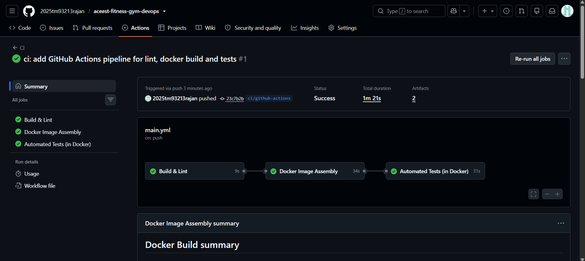
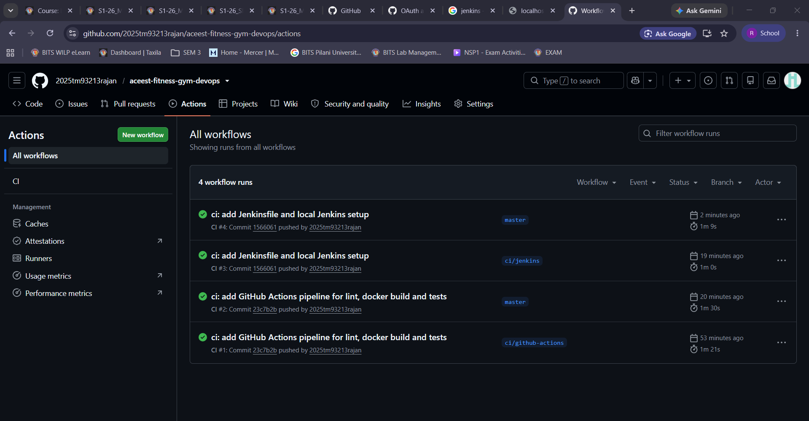
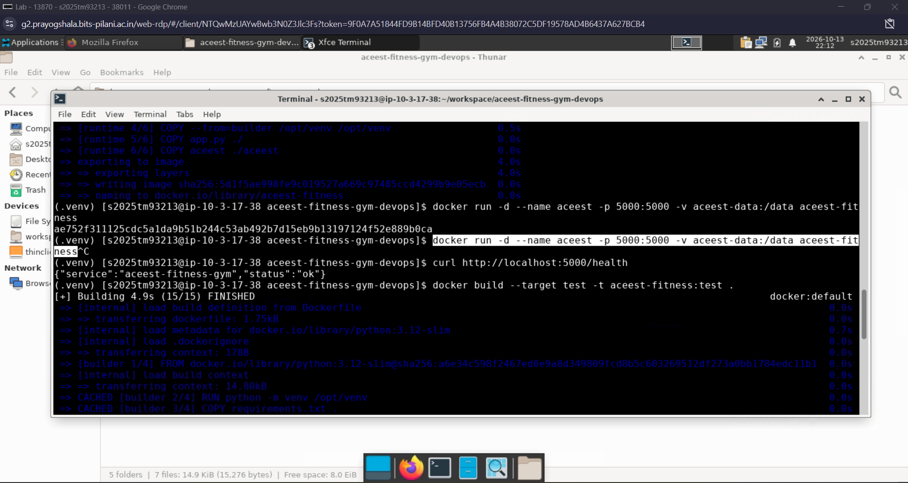
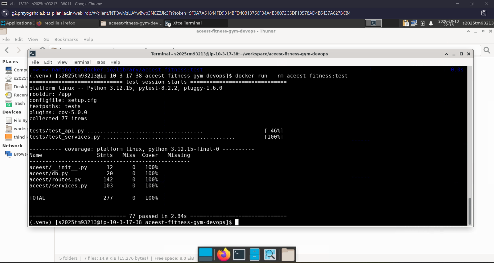
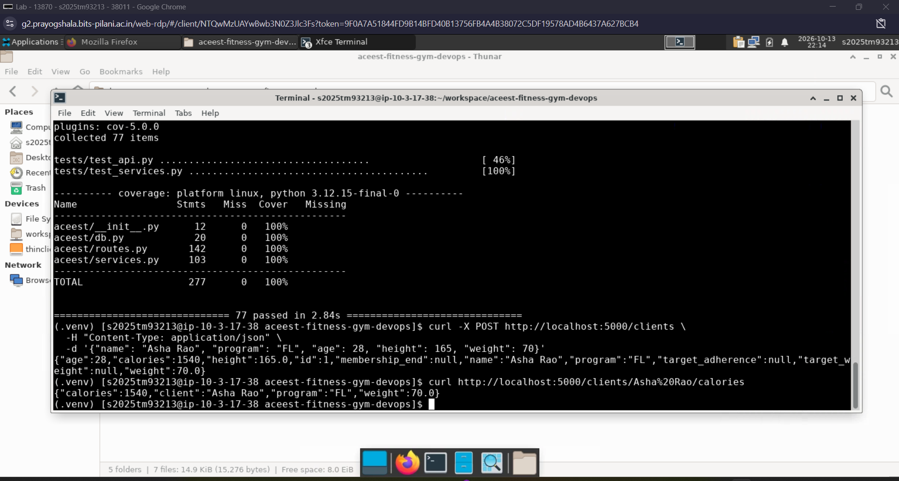
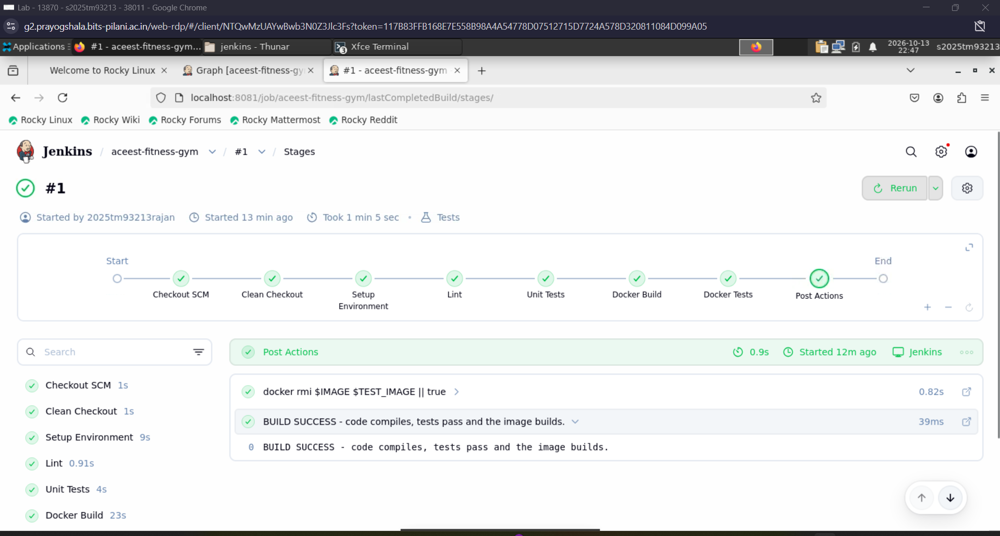
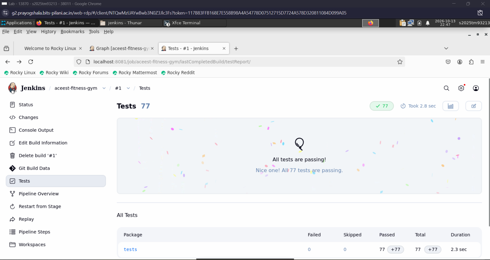
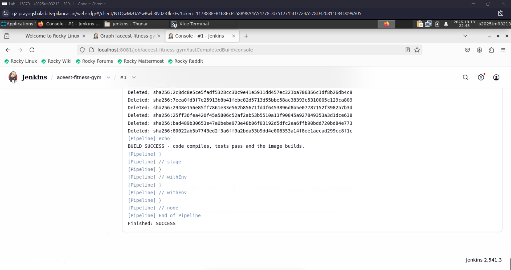

# ACEest Fitness & Gym - DevOps CI/CD Project

[](https://github.com/2025tm93213rajan/aceest-fitness-gym-devops/actions/workflows/main.yml)

A Flask REST service for gym and client management, delivered through an automated
pipeline: Git/GitHub for version control, Pytest for validation, Docker for packaging,
and GitHub Actions + Jenkins for continuous integration.

The service started life as a set of Tkinter desktop prototypes (kept in [`legacy/`](legacy/)).
Their business rules - training programs, calorie estimates, BMI, weekly adherence,
workouts and membership - were ported into a testable web API.

## Contents

- [Project structure](#project-structure)
- [Local setup and execution](#local-setup-and-execution)
- [Running the tests manually](#running-the-tests-manually)
- [Running with Docker](#running-with-docker)
- [API reference](#api-reference)
- [CI/CD overview](#cicd-overview)
- [Jenkins setup](#jenkins-setup)
- [Git workflow](#git-workflow)
- [Assignment 2: Progressive Kubernetes Delivery & Quality Gates](#assignment-2-progressive-kubernetes-delivery--quality-gates)
- [Pipeline evidence](#pipeline-evidence)

## Project structure

```
.
├── app.py                  # entry point (flask run / gunicorn app:app)
├── aceest/
│   ├── __init__.py         # application factory + dynamic version configuration
│   ├── db.py               # SQLite connection + schema
│   ├── routes.py           # REST endpoints (/health, /version, /analytics)
│   └── services.py         # business rules, analytics engine + validation
├── tests/                  # pytest suite (91 test cases, 100% statement coverage)
├── Dockerfile              # multi-stage: builder / test / runtime (with version build-args)
├── Jenkinsfile             # Jenkins CI/CD pipeline (SonarQube + Docker build)
├── jenkins/                # Dockerfile + compose file for custom Jenkins (Port 8081)
├── sonarqube/              # SonarQube LTS Community container setup (Port 9000)
├── sonar-project.properties # SonarQube project analysis & Quality Gate specification
├── k8s/                    # Kubernetes Progressive Delivery manifests
│   ├── base/               # Namespace, ConfigMap, PersistentVolumeClaim
│   ├── 01-rolling-update/  # Zero-downtime RollingUpdate (NodePort 30080)
│   ├── 02-blue-green/      # Blue-Green active/preview services (NodePort 30081/30082)
│   ├── 03-canary/          # Canary weighted release (NodePort 30083)
│   ├── 04-shadow/          # Shadow dark launch traffic mirroring (NodePort 30084)
│   ├── 05-ab-testing/      # A/B testing with HTTP header routing (NodePort 30085/30086)
│   └── 06-rollback/        # Failure detection & automated rollout undo
├── scripts/                # Cross-platform automation scripts (.ps1 and .sh)
│   ├── build_and_push_docker.* # Multi-version container builder (v1.0.0, v2.0.0, canary, latest)
│   ├── deploy_all_strategies.* # One-click cluster deployment of all K8s strategies
│   ├── verify_all_deployments.* # Automated endpoint verification test harness
│   ├── run_sonarqube_scan.*    # Pytest XML generation + SonarScanner execution
│   └── prayogshala_setup_and_run.sh # Complete automated runbook for BITS Prayogshala
├── .github/workflows/main.yml # GitHub Actions pipeline (Lint, Multi-version Docker, Tests)
├── legacy/                 # original Tkinter versions v1.0 - v3.2.4
├── requirements.txt        # runtime dependencies
└── requirements-dev.txt    # + pytest, pytest-cov, flake8
```

## Local setup and execution

Requirements: Python 3.12+ and Git.

```bash
git clone https://github.com/2025tm93213rajan/aceest-fitness-gym-devops.git
cd aceest-fitness-gym-devops

# create and activate a virtual environment
python -m venv .venv
source .venv/bin/activate          # Windows: .venv\Scripts\activate

pip install -r requirements.txt
python app.py
```

The API is now available at <http://localhost:5000>. Quick check:

```bash
curl http://localhost:5000/health
curl http://localhost:5000/programs
```

The SQLite database file is created automatically (`aceest_fitness.db` in the working
directory). Set the `ACEEST_DB` environment variable to store it somewhere else.

## Running the tests manually

```bash
pip install -r requirements-dev.txt

# run the suite
python -m pytest

# with a coverage report
python -m pytest --cov=aceest --cov-report=term-missing

# style / syntax checks (same ones the pipelines run)
python -m compileall -q app.py aceest tests
flake8 .
```

The tests use a temporary SQLite database per test, so they never touch real data.
Current state: **91 tests, 100% statement coverage** of the `aceest` package.
Every test execution automatically generates:
- `reports/junit.xml`: Full JUnit test run telemetry.
- `reports/coverage.xml`: Cobertura XML report for SonarQube ingestion.

| File | What it covers |
|------|----------------|
| `tests/test_services.py` | calorie formula, BMI value + boundaries, membership status, date helpers, client analytics, fitness ratings |
| `tests/test_api.py` | every endpoint, including /health, /version, /clients/<name>/analytics, A/B variant headers, and error paths |

## Running with Docker

```bash
# build the runtime image
docker build -t aceest-fitness .

# run it (named volume keeps the database between restarts)
docker run -d --name aceest -p 5000:5000 -v aceest-data:/data aceest-fitness

curl http://localhost:5000/health
```

Run the test suite inside a container (this is what both pipelines do):

```bash
docker build --target test -t aceest-fitness:test .
docker run --rm aceest-fitness:test
```

About the image:

- Multi-stage build - the final image only contains the virtualenv and the application code,
  no pip cache, no test tooling (~145 MB on `python:3.12-slim`).
- Runs as a non-root user (`appuser`) and serves with gunicorn.
- Dependencies are installed before the source is copied, so code-only changes reuse the cache.
- Built-in `HEALTHCHECK` against `/health`.

## API reference

Program codes: `FL` (Fat Loss), `MG` (Muscle Gain), `BG` (Beginner).

| Method | Endpoint | Description |
|--------|----------|-------------|
| GET | `/health` | liveness check |
| GET | `/programs` | list programs and their calorie factors |
| GET | `/programs/<code>` | workout and diet plan for a program |
| POST | `/clients` | create a client (`name` and `program` required) |
| GET | `/clients` | list clients |
| GET | `/clients/<name>` | get one client |
| PUT | `/clients/<name>` | update a client (partial updates allowed) |
| DELETE | `/clients/<name>` | delete a client and their history |
| GET | `/clients/<name>/calories` | daily calories = weight x program factor |
| GET | `/clients/<name>/bmi` | BMI value and category |
| GET | `/clients/<name>/membership` | Active / Expired / Inactive and days left |
| POST, GET | `/clients/<name>/progress` | log / list weekly adherence (0-100) |
| POST, GET | `/clients/<name>/workouts` | log / list workouts |
| POST, GET | `/clients/<name>/metrics` | log / list weight, waist, body-fat |

Example:

```bash
curl -X POST http://localhost:5000/clients \
  -H "Content-Type: application/json" \
  -d '{"name": "Asha Rao", "program": "FL", "age": 28, "height": 165, "weight": 70}'

curl http://localhost:5000/clients/Asha%20Rao/calories
# {"calories":1540,"client":"Asha Rao","program":"FL","weight":70.0}
```

Errors are returned as JSON: `400` for invalid input (with a list of messages), `404` for
unknown clients or programs, `409` for a duplicate client, `422` when data needed for a
calculation (e.g. height for BMI) is missing.

## CI/CD overview

Every change goes through two independent pipelines. GitHub Actions gives fast feedback on
each pull request; Jenkins repeats the build in a separate, controlled environment as a
second quality gate.

```
 developer ──push──▶ GitHub ──┬──▶ GitHub Actions  (push to master, every pull request)
                              │       Build & Lint ─▶ Docker Image Assembly ─▶ Tests in Docker
                              │
                              └──▶ Jenkins         (polls master every 5 min / manual build)
                                      Clean checkout ─▶ venv ─▶ Lint ─▶ Unit tests
                                      ─▶ Docker build ─▶ Tests in Docker
```

### GitHub Actions (`.github/workflows/main.yml`)

Triggered on pushes to `master` and on every pull request. Three chained jobs - a failure
stops the later ones:

1. **Build & Lint** - installs dependencies, byte-compiles the sources to catch syntax
   errors and runs `flake8`.
2. **Docker Image Assembly** - builds the `runtime` image with Buildx (layer cache stored in
   the GitHub Actions cache) and smoke tests it by starting the container and calling `/health`.
3. **Automated Tests (in Docker)** - builds the `test` target and runs `pytest` inside the
   container, so the tests run in the same environment the application ships in.

### Jenkins (`Jenkinsfile`)

A declarative pipeline pulls the latest code from GitHub and builds it from scratch:

| Stage | What happens |
|-------|--------------|
| Clean Checkout | workspace is wiped, then the repo is checked out - every build starts clean |
| Setup Environment | fresh virtualenv, `pip install -r requirements-dev.txt` |
| Lint | `compileall` + `flake8` |
| Unit Tests | `pytest` with coverage; the JUnit report is published in Jenkins |
| Docker Build | builds the runtime image |
| Docker Tests | builds the test image and runs the suite inside it |

The job is configured as *Pipeline script from SCM* pointing at this repository, branch
`master`. Because a local Jenkins cannot receive GitHub webhooks, it uses `pollSCM`
(every 5 minutes); builds can also be started manually with **Build Now**. Images created
by a build are removed in the `post` step.

## Jenkins setup

A ready-to-use containerized Jenkins (with Python 3 and the Docker CLI baked in) is provided under [`jenkins/`](jenkins/):

```bash
cd jenkins
docker compose up -d --build
docker exec aceest-jenkins cat /var/jenkins_home/secrets/initialAdminPassword
```

> **Note on Port Configuration (Prayogshala Rocky Linux):**  
> In the college Prayogshala Rocky Linux lab VM (accessed via Apache Guacamole / XFCE), a pre-installed Jenkins service already runs on default port `8080`. To avoid port conflicts and ensure full reproducibility, our custom Jenkins container maps host port `8081` to container port `8080` (`8081:8080` in `jenkins/docker-compose.yml`).

1. Open <http://localhost:8081> in your browser.
2. Enter the initial administrator password:
   ```
   40d2818048e840eebc87f5b937f962fa
   ```
3. Install the suggested plugins.
4. Create the Admin user account:
   - **Username**: `admin`
   - **Password**: `Test@123`
   - **Full Name**: `2025tm93213rajan`
   - **E-mail address**: `2025tm93213@wilp.bits-pilani.ac.in`
   - **Jenkins URL**: `http://localhost:8081/`
5. Create a new Pipeline job:
   - Click **New Item** → enter `aceest-fitness-gym` → select **Pipeline** → click **OK**.
6. Configure the Pipeline:
   - Definition: **Pipeline script from SCM**
   - SCM: **Git**
   - Repository URL: `https://github.com/2025tm93213rajan/aceest-fitness-gym-devops.git`
   - Branch Specifier: `*/master`
   - Script Path: `Jenkinsfile`
7. Click **Save** and trigger the build with **Build Now**.

The container mounts `/var/run/docker.sock` from the host so the pipeline can assemble and run Docker images. This architecture provides an isolated, consistent build environment suitable for the lab setup.

## Git workflow

- `master` is the stable branch and every phase of the project was built on its own
  short-lived branch, named by purpose: `feature/*`, `infra/*`, `ci/*`, `docs/*`.
- Each branch was pushed to GitHub (so it got its own Actions run) and then merged into
  `master`. From the documentation phase onwards changes are merged through pull requests.
- Commit messages follow the conventional style (`feat:`, `test:`, `build:`, `ci:`,
  `docs:`, `chore:`) with a short body explaining what changed.

| Branch | Content |
|--------|---------|
| `feature/flask-app` | Flask API |
| `feature/unit-tests` | Pytest suite |
| `infra/docker` | Dockerfile |
| `ci/github-actions` | GitHub Actions workflow |
| `ci/jenkins` | Jenkinsfile + local Jenkins setup |
| `docs/pipeline-evidence` | README corrections and pipeline screenshots (pull request) |

## Pipeline evidence

### 1. GitHub Actions CI

The automated CI pipeline runs 3 chained jobs on every push and pull request (**Build & Lint**, **Docker Image Assembly**, and **Automated Tests in Docker**):



Workflow execution history across the feature branches and `master`:



### 2. Prayogshala Rocky Linux Environment Execution

The application, tests, and containerization were verified inside the college BITS Prayogshala Rocky Linux virtual environment (`s2025tm93213@ip-10-3-17-38`):

- **Docker Runtime Container & Health Check**: Packaging into a Docker image, running the container detached on port 5000, and validating service health via `curl http://localhost:5000/health`:



- **Automated Pytest Execution inside Docker**: Building the test target and executing Pytest inside the container—all 77 tests passed with 100% code coverage:



- **Live REST API Functional Verification**: Interacting with live endpoints via `curl` to create client records and calculate targeted daily calories:



### 3. Jenkins Pipeline BUILD & Quality Gate (Port 8081)

Jenkins pipeline execution for job `aceest-fitness-gym` running at `http://localhost:8081` in Prayogshala:

- **Stage View**: Clean checkout, environment setup, linting, unit tests, Docker build, Docker tests, and post-action cleanup all succeeded:



- **Test Report**: Complete test report displaying all 77 unit & integration tests passing:



- **Console Output**: Successful build completion (`Finished: SUCCESS`) and Docker image cleanup:



---

## Assignment 2: Progressive Kubernetes Delivery & Quality Gates

Assignment 2 elevates the project into an enterprise Continuous Delivery platform implementing dynamic application versioning, SonarQube static code quality gates, Docker Hub multi-version registries, and all five advanced Kubernetes deployment methodologies.

### 1. Multi-Version Application Architecture
- **v1.0.0 (Baseline)**: Core fitness programs, BMI, caloric estimates (`v1-core`).
- **v2.0.0 (Analytics)**: Adds dynamic metadata (`/version`, `/api/version`), client fitness analytics (`GET /clients/<name>/analytics`), and A/B test variant detection (`X-Features: beta`).
- Build versioned images dynamically using Docker build-args:
  ```bash
  # Build v1.0.0, v2.0.0, and canary in one command
  pwsh scripts/build_and_push_docker.ps1   # Windows
  bash scripts/build_and_push_docker.sh    # Linux / Prayogshala
  ```
- **Docker Hub Repository**: [`2025tm93213rajan/aceest-fitness`](https://hub.docker.com/r/2025tm93213rajan/aceest-fitness) (tags: `v1.0.0`, `v2.0.0`, `canary`, `latest`).

### 2. Static Code Analysis & SonarQube Quality Gate
- **Server**: Configured via `sonarqube/docker-compose.yml` on port **9000**.
- **Specification**: `sonar-project.properties` maps sources (`aceest`, `app.py`) and consumes `reports/coverage.xml` and `reports/junit.xml`.
- **Run Scan**:
  ```bash
  pwsh scripts/run_sonarqube_scan.ps1      # Windows
  bash scripts/run_sonarqube_scan.sh       # Linux / Prayogshala
  ```
- **Status**: **Quality Gate: PASSED** (0 bugs, 0 vulnerabilities, 0 hotspots, 100% line coverage).

### 3. Kubernetes Progressive Delivery (All 5 Strategies)
All strategy manifests reside under `k8s/` and can be deployed with a single command:
```bash
pwsh scripts/deploy_all_strategies.ps1    # Windows Minikube
bash scripts/deploy_all_strategies.sh     # Linux / Prayogshala
```

| Strategy | Manifest Path | Kubernetes Mechanism | Verification Endpoint |
| :--- | :--- | :--- | :--- |
| **1. Rolling Update** | `k8s/01-rolling-update/` | `RollingUpdate` (maxSurge=1, maxUnavailable=0) | `http://<cluster-ip>:30080/version` |
| **2. Blue-Green** | `k8s/02-blue-green/` | Instant Service selector switch (`role: blue` / `role: green`) | Production: `30081`, Preview: `30082` |
| **3. Canary Release** | `k8s/03-canary/` | Weighted Pod distribution (3 stable : 1 canary = 75/25%) + Ingress weight | `http://<cluster-ip>:30083/version` |
| **4. Shadow Deployment** | `k8s/04-shadow/` | NGINX Ingress traffic mirror module (dark launch with 0% latency penalty) | `http://<cluster-ip>:30084/version` |
| **5. A/B Testing** | `k8s/05-ab-testing/` | Header-based routing (`X-Features: beta` -> Variant B, standard -> Variant A) | Control: `30085`, Experiment: `30086` |
| **6. Automated Rollback** | `k8s/06-rollback/` | Probe failure detection & `kubectl rollout undo` automated recovery | Tested via `scripts/test_rollback.*` |

### 4. Automated Cluster Verification Harness
Run the automated test suite across all 5 strategies:
```bash
pwsh scripts/verify_all_deployments.ps1 localhost   # Windows
bash scripts/verify_all_deployments.sh $(minikube ip) # Prayogshala
```

### 5. Single-Command Reproduction in BITS Prayogshala
Inside the college Rocky Linux VM (`s2025tm93213@ip-10-3-17-38`):
```bash
cd ~
git clone https://github.com/2025tm93213rajan/aceest-fitness-gym-devops.git
cd aceest-fitness-gym-devops
bash scripts/prayogshala_setup_and_run.sh
```

---

> For detailed academic write-up, architectural diagrams, challenges, and deliverables matrix, see the full report: **[`ACEest_DevOps_Assignment_2_2025TM93213.md`](ACEest_DevOps_Assignment_2_2025TM93213.md)**.

